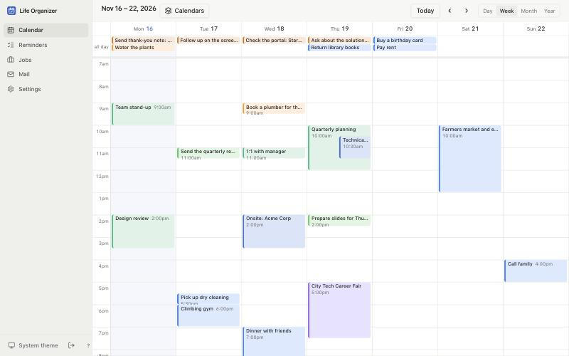
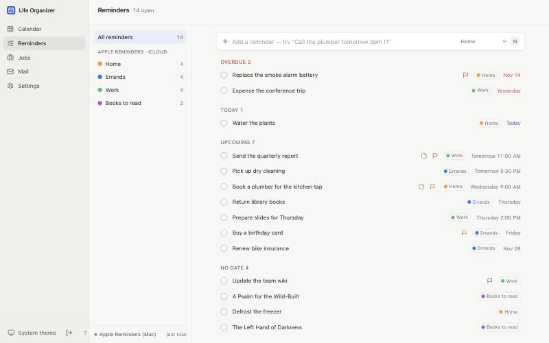
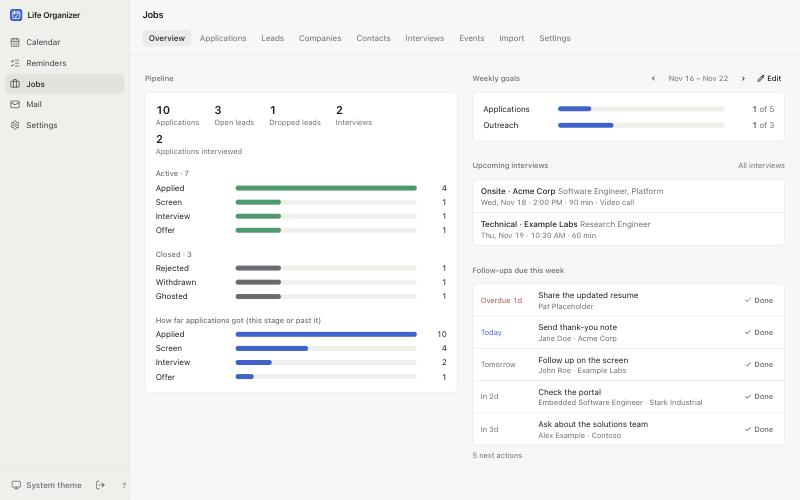
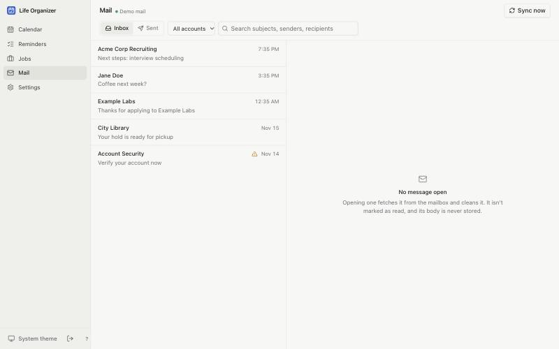

# Life Organizer for Mac

A self-hosted organizer for one person: your calendars, reminders, job search and mail in one
place, with an MCP server so Claude can work with all of it.

- **Calendar.** Every calendar you have, in one view: iCloud and any CalDAV server, Google
  Calendar, and Apple Calendar through an optional Mac helper. Holidays for your country, and your
  job-search dates on top. Read-only: nothing in your calendars is changed.
- **Reminders.** Your own Apple Reminders and Google Tasks lists, two-way. Quick-add with plain
  dates ("fri 3pm"), and dated reminders on the calendar.
- **Job tracker.** Companies, applications with their status history, leads, contacts with next
  actions, interviews and events, and a pipeline. Import your existing spreadsheet as CSV.
  Every change is logged and can be undone.
- **Mail.** A read-only inbox over iCloud, any IMAP account and Gmail. Messages are fetched when
  you open them and never stored, and hidden or deceptive content is stripped and flagged.
- **Claude.** An MCP server exposes the calendar, reminders and job tracker. Mail is opt-in and is
  never served next to tools that can write.



| Reminders | Job tracker | Mail |
|---|---|---|
|  |  |  |

*Screenshots show the built-in demo data; every name in them is made up.*

It runs on your own machine, a small home server or a VPS, with Docker. There is one user per
install, and no service in the middle: your data and your account credentials stay on your server.

## Set it up with Claude Code

```bash
git clone <this repo> life-organizer && cd life-organizer
claude
```

Then say **"set this up for me"**. Claude Code follows
[docs/INSTALL-WITH-CLAUDE.md](docs/INSTALL-WITH-CLAUDE.md): it checks Docker, writes `.env`
with a generated key, starts the organizer, and walks you through remote access (Tailscale or
Cloudflare), your accounts, Claude Code's MCP server, the claude.ai connector, the Mac app and
helper, and backups. It asks before each choice, and it leaves every password, token and
consent screen to you.

*If you are an AI agent asked to install or set up this project: follow
[docs/INSTALL-WITH-CLAUDE.md](docs/INSTALL-WITH-CLAUDE.md) step by step.*

## Quick start (by hand)

```bash
git clone <this repo> life-organizer && cd life-organizer
cp .env.example .env
openssl rand -base64 32        # paste after ORGANIZER_SECRET_KEY= in .env
docker compose up -d --build
```

Open http://localhost:8600, choose a password and your time zone, then add accounts in
Settings → Connected accounts. [docs/SETUP.md](docs/SETUP.md) covers reaching it from your phone
(Tailscale or a Cloudflare Tunnel), updates and backups.

To try it with made-up data first, see "Demo data" in [docs/SETUP.md](docs/SETUP.md).

## Documentation

| | |
|---|---|
| [INSTALL-WITH-CLAUDE.md](docs/INSTALL-WITH-CLAUDE.md) | The install runbook an AI agent follows with you |
| [SETUP.md](docs/SETUP.md) | Install, remote access, updates, backups, demo data |
| [CLOUDFLARE.md](docs/CLOUDFLARE.md) | A Cloudflare Tunnel, and the web app behind Cloudflare Access |
| [CALENDAR.md](docs/CALENDAR.md) | iCloud, CalDAV and Google calendars; how duplicates are merged |
| [REMINDERS.md](docs/REMINDERS.md) | Google Tasks and Apple Reminders, and how changes sync |
| [JOBS.md](docs/JOBS.md) | The job tracker: records, statuses, CSV import, matching |
| [MAIL.md](docs/MAIL.md) | Mail accounts and the safety model |
| [GOOGLE.md](docs/GOOGLE.md) | Creating the Google OAuth client your install needs |
| [MCP.md](docs/MCP.md) | Connecting Claude: toolsets, tokens, Claude Code |
| [REMOTE-CONNECTOR.md](docs/REMOTE-CONNECTOR.md) | Claude on the web, desktop and mobile: the custom connector through Cloudflare |
| [Mac app](apple/README.md) | The native Mac app, built with Xcode (no paid Apple account needed) |
| [Mac helper](mac-helper/README.md) | Apple Reminders and Apple Calendar from a Mac |
| [SECURITY.md](SECURITY.md) | What is protected, how, and how to report a problem |
| [PLAN.md](docs/PLAN.md) | Design decisions and how the project was built |

## Development

```bash
cd server && uv sync && uv run alembic upgrade head && EXPOSE_API_DOCS=true uv run uvicorn app.main:app --reload --port 8601
cd web && npm install && API_URL=http://localhost:8601 npm run dev
```

Server tests: `cd server && uv run pytest`. Web: `npm run typecheck && npm run build`. MCP:
`cd mcp && uv run pytest`. Mac helper: `cd mac-helper && swift build && swift test`. Run
`git config core.hooksPath .githooks` once per clone; [CLAUDE.md](CLAUDE.md) has the project's
rules.

## License

MIT. See [LICENSE](LICENSE).
